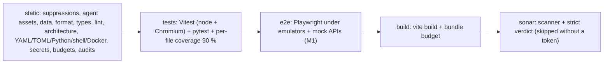

# CI Quality Gates Skill

Every gate of **Historic City Map**, in the order the pipeline runs it: the command (as registered in `scripts/ci/pipeline.py`), its configuration, what it fails on, and how to fix a failure **without an inline suppression**. Which gates make up which stage, and what `quality` and `all` mean, is defined only in `quality/pipeline_skill.md` → *Stages*.

Every gate runs inside `hcm-quality:local`; npm tools are invoked as `npm run --silent <script>`, so `package.json` is the one place their flags live. The gates of a stage run several at once and print their output gate by gate in this order (`.agent/skills/quality/pipeline_skill.md` → *How a run works*). A gate with a file pathspec is skipped (and counts as passed) while no file matches it.

---

## Stage `static`

| Gate | Command | Configuration | Fails on | Fix |
| --- | --- | --- | --- | --- |
| `suppressions` | `python3 scripts/ci/check_no_inline_suppressions.py` | patterns in the script | any inline directive that silences a tool: ESLint, TypeScript, coverage hints, Prettier (TS, CSS, HTML, YAML, Markdown), stylelint, focused, skipped or expected-to-fail tests (also behind chained modifiers such as `it.concurrent.only` or `test.describe.serial.skip`, Playwright's `test.fail(` and `testInfo.skip()`/`fixme()`), knip/depcruise/jscpd markers, `NOSONAR`, gitleaks markers, ruff/mypy/pylint/pyright/bandit comments, `fmt: off`/`fmt: skip`/`isort: skip`, coverage pragmas, pytest and unittest skip/xfail, shellcheck directives (also inside workflow `run:` scripts), hadolint and BuildKit `check=skip` directives, yamllint and zizmor directives, live markdownlint comments; `.pyi` stubs included | Fix the finding the directive hid. A genuine relaxation goes into the tool's single config with a why-comment (ask first for lint configs). A test that needs a directive as data assembles it from fragments. |
| `skill-mirrors` | `python3 scripts/ci/check_skill_mirrors.py` | none | a file that differs or exists on one side only between `.agents/skills` and `.claude/skills`; a `SKILL.md` without front matter, with a `name` other than its folder, or without a description | Edit `.agents/skills/<name>/SKILL.md`, then `cp` it over `.claude/skills/<name>/SKILL.md`. |
| `agent-assets` | `python3 scripts/ci/check_agent_assets.py` | budgets in the script; *Planned paths* in `docs/research/M0-handoff.md` | `AGENTS.md` above 24,000 bytes, an AGENTS.md chain above 32,768 bytes, a skill or `.agent/skills` document above 500 lines, a bad skill name or description (above 1,024 characters, angle brackets), a subagent without `name`, `description`, `tools`; a back-ticked path or relative link in `AGENTS.md`, `CLAUDE.md`, `README.md`, `.agent/`, `.agents/`, `.claude/`, `docs/` (not `docs/research/`) that does not exist, is not git-ignored (a missing path is also asked as a folder, so an unbuilt `dist` of a fresh clone counts as ignored) and is not planned | Move detail into a skill; fix the path; list a deliberate future path under *Planned paths* (and remove it when the file lands). |
| `data-files` | `python3 scripts/ci/check_data_files.py` | none | a JSON, GeoJSON, `.firebaserc`, TOML, XML or SVG file that does not parse; a duplicate JSON key | Fix the file (JSONC and `tsconfig*.json` are left to their tools). |
| `firebase-schema` | `check-jsonschema --schemafile node_modules/firebase-tools/schema/firebase-config.json <firebase.json>` | the firebase-tools schema | an invalid `firebase.json` | Fix the key or value the schema names. |
| `editorconfig` | `python3 scripts/ci/check_editorconfig.py` | `.editorconfig` | a BOM or non-UTF-8 text, a wrong line ending, a missing final newline, trailing whitespace, a tab where spaces are required | Fix the file; the language formatters handle indent size and line length. |
| `e2e-matrix` | `python3 scripts/ci/check_e2e_matrix.py check` | `e2e/scenarios.json` | a malformed or unknown row field, a duplicate id, a behaviour without a happy or a bad row, a test tag without a row, an `exists` row without a test, a `planned` row with one, an out-of-date `docs/E2E_SCENARIOS.md` | Fix the row or the tag; then `python3 scripts/ci/check_e2e_matrix.py write` (in the image) regenerates the doc. |
| `i18n` | `python3 scripts/ci/check_i18n.py` | the catalogues in `packages/*/src/i18n/` and the folders directly inside one (`packages/shared/src/i18n/api/`) | a catalogue missing for a locale, keys that differ between `ro` and `en`, an empty message, different `{placeholder}` names, a line the parser cannot read | Add the key to both catalogues, one flat entry per line, Romanian first. |
| `fonts` | `npm run --silent fonts:check --workspace @hcm/ui` (`packages/ui/scripts/build-fonts.mjs --check`) | `packages/ui/src/icons.ts`, `packages/ui/src/fonts/font-files.ts` | a committed file in `packages/ui/fonts/` that differs from an in-memory rebuild, or a name in `ICONS` that does not shape to exactly one glyph of the subset (it would render as nothing or as letters) | Add the icon to `UI_ICONS` (or the POI list), then `npm run fonts:build --workspace @hcm/ui` in the image and commit the rebuilt files. |
| `prettier` | `npm run format:check` (`prettier --check --cache --cache-location reports/.cache/prettier/cache.json .`: only files that passed are cached, keyed on content, options and Prettier's version) | `.prettierrc.json` (140 columns, 4 spaces, single quotes), `.prettierignore` | TS, JS, JSON, YAML, CSS not formatted | `npx prettier --write <file>` in the image. Markdown is excluded (markdownlint owns it). |
| `tsc` | `npm run typecheck` (`tsc -b`) | `tsconfig.base.json`, root `tsconfig.json` references, `<pkg>/tsconfig.json` and `<pkg>/test/tsconfig.json`, `tsconfig.tools.json` | any type error in src, tests or tool configs (strict, `noUncheckedIndexedAccess`, `exactOptionalPropertyTypes`, `noPropertyAccessFromIndexSignature`) | Type the code; never `any`, a non-null `!` or a cast to silence it. A new package adds both projects to the root references. |
| `eslint` | `npm run lint` (`--max-warnings 0 --no-inline-config`; `--concurrency` a quarter of the CPUs, at least 2: four worker threads on 16, measured on the busy laptop at 45 s against 87 s on one thread and 69 s on eight (`docs/research/pipeline-baseline.md`); no `--cache`, which is unsafe with type-aware rules) | `eslint.config.js` | `strictTypeChecked` + `stylisticTypeChecked`, sonarjs, no-unsanitized, lit and wc plugins, Vitest rules on tests (the CLIs' tests in `scripts/*/test` and `packages/*/scripts/test` included); `eslint-plugin-playwright`'s recommended rules on `e2e/` (no sleeps, no focused or skipped tests, no `networkidle`, no forced clicks, web-first assertions, no conditionals in a test body, every test asserts; assertion helpers are named `expect…`); Lit's `styleMap` (the city page's CSP refuses its `style` attribute); the product limits also on the site build (`scripts/site/src`, `build-site.ts`, `build-admin.ts`); complexity above 5 (default values in a destructuring count, one each, as do `&&`, `\|\|`, `??` and optional chaining `?.`), cognitive complexity above 10, depth above 3, a file above 400 lines, a function above 60, more than 4 parameters (tests and `e2e/`: 600 / 120 / 8); `console`, decorators, HTML sinks, `unsafeHTML`, `eval`, `new Function` | Split the function, introduce a type or an options object, move the branch into a lookup table, render with Lit or `textContent`, log through `createLogger`. `sonarjs/super-linear-regex` flags patterns where two quantifiers can match the same text (a `Link` header regex): split the string instead; `sonarjs/no-clear-text-protocols` flags `http://` literals other than loopback (a test builds the URL and sets its `protocol`); a build script (`.mjs`) imports `process` from `node:process` and dynamic-imports a literal path (`no-unsanitized/method`); `sonarjs/no-os-command-from-path` refuses spawning `npm` from `PATH` (run `process.execPath` with npm's CLI next to it, `functions/deploy-lock.mjs`). An e2e branch on the window class goes into a helper (`closeModalSheet`, `isDocked` in `e2e/support/viewer.ts`), a long journey into one function per step (`e2e/admin/specs/journey.spec.ts`). |
| `stylelint` | `npm run lint:css` (`--cache` in `reports/.cache/stylelint/`, content strategy: a file with any problem, disable-comment problems included, is never cached) | `stylelint.config.js` (standard config, `postcss-lit` for `css` templates in TS) | unknown properties or values, duplicates, descending specificity, a hex or named colour | Use the M3 colour tokens (`--md-sys-color-*`); colours are generated per city in `packages/ui/src/theme`. |
| `htmlhint` | `npm run lint:html -- <files>` | `.htmlhintrc` | tag pairs, lowercase, quotes, doctype, unique ids, title | Fix the markup. Skipped until an HTML file exists (`sites/`, `starter-kit/`, the admin entry). |
| `html-validate` | `npm run lint:html:validate -- <files>` | `.htmlvalidate.json` (recommended rules plus the `html-validate:prettier` preset, which only turns off `doctype-style`, `void-style` and `attr-quotes`, the rules Prettier's output contradicts) | invalid HTML, inline script or style against the CSP, missing `lang`, a cross-origin file without Subresource Integrity | Fix the markup; no inline `<script>`. Skipped while no `.html` file is committed: the site and admin pages are generated (`pipeline_skill.md` → *Local tooling quirks*). |
| `markdownlint` | `npm run lint:md` (`markdownlint-cli2`) | `.markdownlint-cli2.jsonc` | any Markdown rule (`MD013`, `MD033`, `MD041` off; `MD024` siblings only) | `governance/doc_update_skill.md` → *Markdown style*. |
| `knip` | `npm run lint:knip` | `knip.json` (the workspaces, plus the site build `scripts/site` and the CLIs' tests in the root workspace and `packages/ui/scripts/test`) | unused files, exports, dependencies; dependencies used but not declared; an exported type nobody imports outside a package's entry file (`functions/src/ports/` keeps secondary types file-local until a consumer imports them); a second export of the same value (`export const b = a` beside `export const a`) | Delete the dead code or the dependency; declare what is imported in that workspace's `package.json`. Add a dependency in the milestone that first imports it. Export a type in the change that first imports it; export one name per value. |
| `dependency-cruiser` | `npm run lint:deps` (over `packages`, `functions`, `e2e`, `firebase/rules-tests` and `scripts/site`) | `.dependency-cruiser.cjs` | cycles, unresolvable imports, phantom or dev dependencies in product code, layering (`shared` below `ui` below `engine`/`admin`; engine and admin independent), any `mapbox-gl` import outside `packages/engine/src/map/mapbox-adapter.ts`; the Firebase SDK in the engine outside `src/telemetry/`, and there anything but the SDK's `app` and `analytics` entry points; Firestore, Auth, Storage or Realtime Database in `engine` or `shared`; `firebase-admin`, `google-auth-library` or `sharp` in `functions/src` outside `adapters/` and `deps.ts`; one functions feature folder importing another; the Firebase SDK in `packages/admin/src` outside `firebase/` and `index.ts`; Lit in `packages/admin`; the admin elements (`packages/ui/src/admin/`) imported by the engine or the viewer's kit | Move the code to the right layer or behind a port; never widen a rule to pass. |
| `yamllint` | `yamllint --strict .` | `.yamllint` (4-space indentation, 140 columns) | any YAML error or warning | Fix the YAML. |
| `taplo-fmt`, `taplo-lint` | `taplo fmt --check`, `taplo lint` | `.taplo.toml` | TOML formatting or syntax | `taplo fmt <file>` in the image. |
| `ruff-check`, `ruff-format` | `ruff check .`, `ruff format --check .` | `ruff.toml` (py314, 140 columns, McCabe 5, `T20` bans `print`; `N802` allowed in `pipeline/typings/**/*.pyi` only, where GDAL's CamelCase names are spelled as GDAL does) | Python lint, complexity above 5, formatting | `ruff format`, split the function, log through `scripts/ci/cilog.py`. |
| `mypy` | `mypy` | `mypy.ini` (strict, `scripts/ci`) | any type error | Type it; stubs for untyped libraries go next to their code (GDAL: `pipeline/typings/osgeo/`). |
| `radon` | `radon cc --no-assert --min B` and `radon mi --min B` over `scripts/ci` (tests included) | none | a block of complexity 6 or more (radon also counts `and`/`or`, comprehension `for`/`if` and ternaries, so it is stricter than ruff C90), a module below maintainability grade A; asserts are not counted (ruff `S101` bans them outside tests) | Split the function: a comprehension with its filter becomes a small named helper, a chain of `if` returns a helper of its own. |
| `bandit` | `bandit -q -r scripts/ci -x scripts/ci/tests --severity-level medium` | the why-comment next to `BANDIT` in `scripts/ci/pipeline.py` | a medium or high finding in the CI scripts (the low ones are the `subprocess` audit markers `B404`/`B603`, which ruff's `S603` relaxation in `ruff.toml` explains, and `B405`, an `xml.etree` type import while parsing goes through defusedxml) | Fix the code: `shell=False` argument lists, defusedxml, no secrets in code. |
| `pipeline-lock` | `poetry --directory pipeline check --lock --strict` (Poetry in `/opt/hcm/poetry`) | `pipeline/pyproject.toml` | `poetry.lock` out of date with `pyproject.toml`, or any Poetry warning | Re-lock in the image (`pipeline/README.md` → *Toolchain*); pin every dependency exactly. |
| `pipeline-mypy` | `mypy --config-file pipeline/pyproject.toml --python-executable /opt/hcm/pipeline-venv/bin/python` | `[tool.mypy]` in `pipeline/pyproject.toml` (strict over `pipeline/src` and `pipeline/tests`) | any type error, an untyped import | Type it; GDAL calls need a stub in `pipeline/typings/osgeo/` (ordinary positional-only `def` stubs under GDAL's names, see its header). |
| `pipeline-radon` | `radon cc --no-assert --min B` and `radon mi --min B` over `pipeline/src` and `pipeline/tests` | none | any block of complexity 6 or more (radon also counts `and`/`or`, comprehensions and ternaries), a module below maintainability grade A; a test's asserts are not counted | Split the function; move branches into a lookup table or a small helper. |
| `pipeline-bandit` | `bandit -q -r pipeline/src` | none | any finding, low severity included (a hard-coded secret-like name, an unsafe call) | Fix the code; a constant named like a secret is renamed, never annotated. |
| `shellcheck` | `shellcheck -x --severity=style <*.sh, scripts/git-hooks/*>` | none | any finding, style included | `[[ ]]`, quote expansions, errors to stderr, a `*)` case branch. |
| `shfmt` | `shfmt -d <same files>` | `.editorconfig` (tabs for shell) | formatting | `shfmt -w <file>` in the image. |
| `hadolint` | `hadolint --failure-threshold warning --disable-ignore-pragma <Dockerfiles>` | none | unpinned images or apt packages, shell pitfalls | Pin by digest and `=x.y*`; split the `RUN`. |
| `actionlint` | `actionlint` | none | workflow syntax, expression types, shellcheck of `run:` blocks | Fix the workflow (editing `.github/workflows/` is ask first). Skipped until a workflow exists. |
| `workflow-schema` | `check-jsonschema --builtin-schema vendor.github-workflows <workflows>` | GitHub's workflow schema | an invalid workflow | Fix the workflow (ask first). |
| `workflow-timeouts` | `check-jsonschema --builtin-schema custom.github-workflows-require-timeout <workflows>` | none | a job without `timeout-minutes` | Give the job a `timeout-minutes` sized to its stage. |
| `action-schema` | `check-jsonschema --builtin-schema vendor.github-actions .github/actions/*/action.yml` | GitHub's action metadata schema | an invalid local composite action (`quality-image`, `upsert-issue`) | Fix the `action.yml`; every `shell:` is explicit in a composite step. |
| `issue-forms-schema`, `issue-config-schema` | `check-jsonschema --builtin-schema vendor.github-issue-forms` / `vendor.github-issue-config` on `.github/ISSUE_TEMPLATE/` | GitHub's issue-form schemas | an invalid issue form or chooser config | Fix the form; GitHub silently drops an invalid one. |
| `action-pins` | `python3 scripts/ci/check_action_pins.py` | none | a `uses:` not pinned to a 40-hex commit SHA with a `# vX.Y.Z` comment; a `docker://` image without a digest | Resolve the SHA of the release tag (`gh api repos/<o>/<r>/git/ref/tags/<tag>`, dereferencing annotated tags). |
| `workflow-policy` | `check-jsonschema --schemafile scripts/ci/workflow-policy.schema.json <workflows, .github/actions/*/action.yml>` | `scripts/ci/workflow-policy.schema.json` | a `pull_request_target` trigger (any form); a workflow without top-level `permissions`; `write-all` or `read-all` on a workflow or job; an `actions/checkout` step without `persist-credentials: false`; a `${{ }}` expression inside a `run:` script (script injection) | Name each permission the job needs; pass the value through `env:` and quote the variable in the script (editing workflows is ask first). |
| `repo-policy` | `python3 scripts/ci/check_repo_policy.py` | lists in the script | a secret-bearing file in git's view (`.env*` except `.env.example`, `.sonar-token`, `*.secret.local`, service-account JSON, `*.p12`), even force-added; a `package.json` dependency or override, a `requirements*.txt` line or a `pyproject.toml` dependency that is not one exact version; a Dockerfile `FROM` or `# syntax=` or a YAML `image:` without an `@sha256:` digest; a `:latest` tag in a Dockerfile, shell script or YAML file; the banned legacy Mapbox account named anywhere but Markdown, `docs/` and `.coderabbit.yaml` | `git rm --cached` the secret file (and the user rotates the secret); pin the exact version (`npm install --save-exact`, `==`) or the digest; remove the reference (legacy data is migrated in M1 without it). |
| `repo-budget` | `python3 scripts/ci/check_repo_budget.py` | budgets in the script | the tree (without `seed/`) above 60 MB, a file outside `seed/` above 5 MB, e2e screenshot baselines above 15 MB | Rasters, tilesets and photos live in Cloud Storage and Mapbox, never in git; trim baselines to the agreed subset. |
| `gitleaks` | `gitleaks dir --redact --no-banner --config .gitleaks.toml ...` | `.gitleaks.toml` (scope allowlist: git-ignored trees and the developer's two local secret files, which `repo-policy` refuses in git's view) | any secret-shaped string in the working tree | Remove the secret and rotate it (the user does). A false positive is reworded (M0: "Never `curl -u`" near `--user uid:gid` tripped the multi-line `curl-auth-user` rule). Never allowlist a tracked path. |
| `gitleaks-history` | `gitleaks git --redact --no-banner --config .gitleaks-history.toml --log-opts="$GITLEAKS_LOG_OPTS" ...` (report `reports/gitleaks-history.json`) | `.gitleaks-history.toml` (no path allowlist: every committed path is scanned) and `.gitleaksignore` (reviewed false positives by exact fingerprint); the commit range comes from `.github/workflows/ci.yml` (PR `base..head`, push `before..HEAD`) | a secret-shaped string added by any commit of the range, even one deleted again later; passes with a notice when `GITLEAKS_LOG_OPTS` is unset (local runs: the pre-commit hook scans each staged change) | As for `gitleaks`, plus rewriting the unpushed commits; a secret already pushed is rotated first. A pushed false positive gets one `.gitleaksignore` line (`commit:file:rule:line`, from the report's `Fingerprint`) with a comment saying why; today only commit `14d4d7b`'s reworded `curl-auth-user` finding (`docs/research/DECISIONS-for-review.md` §6a). |
| `commits` | `python3 scripts/ci/check_commits.py` | the rule in the script (types, subject regex, 100 characters) | in CI, a non-merge commit of `COMMIT_RANGE` (else the `GITLEAKS_LOG_OPTS` range of `ci.yml`; `base..head` or one revision) whose subject is not `type(scope): summary` with type `feat`, `fix`, `docs`, `refactor`, `test`, `build`, `ci`, `perf`, `chore` or `revert` and a lower-case scope, is longer than 100 characters, has no blank line before its body, or is a `fixup!`/`squash!`/`amend!` commit; a range that is not a revision (exit 2); passes with a notice when neither variable is set (local runs: `scripts/git-hooks/commit-msg` checks each message with `--message-file`) | Reword the unpushed commits (`git rebase -i`, `reword`; squash the autosquash commits); a pushed commit is the user's call (a force-push is ask first). |
| `pytest` | `python3 -m pytest` (also a `tests` gate; one run of `quality` or `all` runs it once and reuses the outcome there) | `pytest.ini`, `.coveragerc` | a failing CI tooling test (`scripts/ci/tests`): a tooling-only change is gated by `static` alone (quality-conventions §4 gate 24) | As in the `tests` stage below. |
| `npm-audit` | `npm audit --audit-level=low` | root `package.json` `overrides` | any advisory, low included | Upgrade, or pin a fixed transitive version in `overrides`; with no upstream fix, vendor a patched copy (`vendor/npm/braces`). Never an allowlist. |
| `deploy-lock-audit` | `npm audit --audit-level=low --prefix functions/deploy-lock` | `functions/deploy-lock/` (the Cloud Functions artifact's `package.json`, with the root overrides, and its lockfile) | any advisory in the tree Cloud Build installs for the functions | Fix it in the root (bump or `overrides`), then refresh the lock with `npm run deploy-lock --workspace @hcm/functions` in the pinned Node image with the network (`firebase/functions_skill.md`). |
| `pip-audit` | `pip-audit --no-deps --disable-pip -r scripts/ci/requirements.txt` | `scripts/ci/requirements.txt` | any advisory in the CI tools | Bump the pin (and its transitive pins). |
| `pipeline-pip-audit` | `pip-audit --path /opt/hcm/pipeline-venv/lib/python3.14/site-packages`, then `-r pipeline/requirements-poetry.txt` | `pipeline/poetry.lock`, `pipeline/requirements-poetry.txt` | any advisory in the pipeline venv or in Poetry's pins | Bump the dependency in `pipeline/pyproject.toml` and re-lock, or bump the Poetry pin set. |

Planned `static` gates: jscpd (at most 2 % duplication), pylint and vulture, each added with its milestone (`docs/research/M0-handoff.md` → *TODO for the next agents*).

Lesson (M0 review): a gate that ignores the environment a workflow hands it is a silent gap. `ci.yml` computed `GITLEAKS_LOG_OPTS` and `run-all-checks.sh` forwarded it, but no gate read it until `gitleaks-history`; when a workflow passes a variable into the container, a gate (and its row here) must consume it.

## Stage `tests`

| Gate | Command | Enforces | Fix |
| --- | --- | --- | --- |
| `vitest` | `npm test` (`firebase emulators:exec --project demo-hcm --only auth,firestore,storage` with `JAVA_TOOL_OPTIONS=-XX:CICompilerCount=2` for the emulators' JVMs, around `scripts/ci/run-emulated-tests.sh`, which sets `METADATA_SERVER_DETECTION=none`, runs `vitest run --coverage` and saves the Firestore rule-coverage report, its JSON and HTML fetched at once) | every test passes in every project of `vitest.config.ts` (shared, engine, admin, functions, `functions-deps` (the composition root's test, alone for its `vi.mock`), rules and `tools` in node, the first four sharing one module graph per worker (`SHARED_MODULE_GRAPH`); ui and `engine-browser` in headless Chromium, their dependencies pre-bundled by `optimizeDeps`); `tools` holds the CLIs' child-process tests (`scripts/seed/test`, `packages/ui/scripts/test`) and the site build's tests (`scripts/site/test`, whose generated pages must pass the repository's `.htmlvalidate.json` through the html-validate library); **90 % per file** for lines, branches, functions and statements over the `coverage` globs of each suite (`scripts/site/src` included) | Add a behaviour test that drives the branch from outside; never an exclusion, never a lower threshold. A new package adds its `SUITES` row with explicit coverage globs (Vitest 5 silently drops unlisted files); a new Lit directive or browser-test dependency joins `BROWSER_TEST_DEPS`. A test that fails only in the shared module graph (another file's state leaks in) restores what it changes; a `vi.mock` in shared, engine, admin or functions moves its file to an isolated project such as `functions-deps`. A setting a test needs (a timeout) goes into its project in `vitest.config.ts`, never into a helper's `vi.setConfig`; an emulator-backed test that times out under load gets the emulator timeouts, never a retry. |
| `rules-coverage` | `python3 scripts/ci/check_rules_coverage.py check` | every expression of `firebase/firestore.rules` evaluated, every `allow` condition seen both allowing and denying, the report made from the current rules (`reports/rules/firestore-coverage.json`) | Add the missing allow or deny row in `firebase/rules-tests/test/` (personas in `support/world.ts`); never drop a condition to pass. |
| `pytest` | `python3 -m pytest` (on at most four pytest-xdist workers, `pytest.ini`) | `scripts/ci/tests` pass, warnings are errors, branch coverage of `scripts/ci` at least 90 % (`.coveragerc`, `fail_under = 90`, the workers' data combined by pytest-cov); non-loopback sockets are blocked | Test through `main(argv)` with fakes and `tmp_path`; run `__main__` through `runpy` instead of excluding it. Tests run in parallel processes: no fixed port (bind port 0), no write outside `tmp_path`; `-n 0` runs one process while debugging. |
| `pipeline-pytest` | `/opt/hcm/pipeline-venv/bin/python -m pytest -c pipeline/pyproject.toml --rootdir .` | `pipeline/tests` pass against the image's real GDAL, warnings are errors, branch coverage into `reports/coverage/pipeline.xml` (the `coverage` gate then holds each file to 90 %); non-loopback connects and DNS lookups are blocked | Drive the code through `main(argv, env, registry, stream)`, the fake M2M server or respx; synthetic rasters go to `tmp_path`, never into the tree. |
| `coverage` | `python3 scripts/ci/check_coverage.py --min 90 --summary reports/coverage/summary.md --badge-dir .github/badges` | every file in the scope of `sonar-project.properties` (sources, exclusions, coverage exclusions, report paths) at 90 % or more, Sonar scoring with line and branch floors; fails on a measured file missing from the reports or a stale report entry | Add behaviour tests; never a coverage exclusion. Commit the updated `.github/badges/coverage.svg` and `.github/badges/branches.svg`. |

## Stage `e2e`

| Gate | Command | Enforces | Fix |
| --- | --- | --- | --- |
| `e2e-matrix` | `python3 scripts/ci/check_e2e_matrix.py check` (also a `static` gate) | the registry and the `@S-...` tags agree in both directions; `docs/E2E_SCENARIOS.md` is current | Flip the row to `exists` when a spec names it, register a new id before tagging it, then `check_e2e_matrix.py write`. |
| `e2e-build` | `python3 scripts/ci/e2e_build.py`: `npm run build:site:e2e` (the engine's, the functions' and the admin's e2e `vite build`, then `e2e/scripts/build-site.ts`) unless its stamp (`node_modules/.cache/hcm/e2e-build.json`) shows no input file changed and no output was touched | `dist/e2e-site/bucharest` (the e2e fixture manifest of `e2e/fixtures/manifest.ts`, so its CSP names the e2e tile and telemetry hosts) and `dist/e2e-site/starter-kit` build | Fix the engine build or the fixture (a committed input that stopped validating is named in the error). A build that should have run but did not: delete the stamp, and add the file the stamp missed to the inputs (`NOT_INPUTS` in `scripts/ci/e2e_build.py` lists what is left out). |
| `playwright` | `npm run test:e2e` (`playwright test` in `e2e/`, config `e2e/playwright.config.ts`, projects `e2e/projects.ts`, `E2E_TIER` picks the tiers) | every spec passes in headless Chromium with SwiftShader WebGL2 against the sites in `dist/e2e-site` and the mock APIs; the automatic fixtures of `e2e/support/test.ts` fail a test on any request outside loopback and the mocked hosts (firewall), on any console error or uncaught page error (console guard) and on visible `undefined`, `null`, `NaN`, `[object Object]` or an unfilled `{param}` (placeholder guard); `setup` validates the fixture manifest first; `forbidOnly`; in CI a flaky test fails (`failOnFlakyTests`) | Mock a new external host in `e2e/mock-apis/` (`hosts.ts`, `router.ts`) or script one response with `page.route` (it wins over the context routes), fix the product's console error; a bad-path test that provokes a block or an error on purpose claims it with `firewall.take()` / `consoleErrors.take()` and asserts it. Traces of failed tests: `reports/test-results/`, HTML report `reports/playwright/`. |
| `playwright-tour-matrix` | `E2E_TIER=tour-matrix npm run test:e2e` (stage `tour-matrix`, in `all` and nightly) | the tour's other 35 viewport, theme and language projects pass, with the same fixtures as `playwright` | As `playwright`: the failing project names the viewport, theme and language; reproduce with `--project tour-<viewport>-<scheme>-<lang>`. |

Today the stage runs the harness (`e2e/specs/harness/`, behaviour V00: WebGL2, the firewall, Mapbox GL drawing the mock APIs' tiles), the viewer smoke on c360 and l1440 (`e2e/specs/smoke/`) and the functional specs (`e2e/specs/viewer/`). The tour and a11y tiers fail on an axe violation (`axe` fixture), a layout invariant (overflow, overlap, clipped text, touch targets below 48 px on compact) or more than one map per view. Fix the product, not the assertion; a screenshot baseline changes only for an intended visual change, reviewed by the `golden-reviewer` subagent.

## Stage `build`

| Gate | Command | Enforces |
| --- | --- | --- |
| `vite-build` | `npm run build` (every workspace's `build`) | `packages/engine/dist/engine.{iife.js,mjs,css}` with `window.HistoricCityMap` and `mapbox-gl` external (global `mapboxgl`); the admin bundle `HistoricCityMapAdmin` |
| `bundle-budget` | `python3 scripts/ci/check_bundle_budget.py` | the gzip size (level 9) of each shipped bundle within its budget in the script (`engine.mjs` 100 KB, minified since `DECISIONS-for-review.md` §17a; `engine.iife.js` 125 KB; `admin.iife.js` 450 KB); a missing bundle fails |
| `site-build` | `npm run build:site` (`scripts/site/build-site.ts`) | `dist/site/bucharest` and `dist/site/starter-kit` build: `site.json`, `config.js` (one literal assignment) and the manifest validate, every photo derivative exists, the engine `dist` and the pinned `mapbox-gl` are present; the token comes from `MAPBOX_PUBLIC_TOKEN` (a warning and the e2e placeholder without it) |

`vite-build` also builds the Cloud Functions artifact (`functions/build.mjs`): every bare import of `functions/dist/index.js`, static or dynamic, must be pinned by its `package.json`; `functions/deploy-lock/` must be made for exactly that `package.json` (its lockfile is copied next to it); `functions/deploy-env.json` must hold only one-line `HCM_*` values (each project's become `dist/.env.<project>`). Planned: the reproducible `dist` on release commits. The site pages, the starter kit's included, are generated and checked against `.htmlvalidate.json` by the `tools` project's tests.

## Stage `release` (on a `v*` tag)

| Gate | Command | Enforces | Fix |
| --- | --- | --- | --- |
| `release-check` | `python3 scripts/ci/check_release.py` (`--tag vX.Y.Z` to check before tagging) | exactly one `vMAJOR.MINOR.PATCH` tag at HEAD, the same version in the root and every workspace `package.json` and in `ENGINE_VERSION`, both `docs/releases/vX.Y.Z.md` and `vX.Y.Z_github_description.md` non-empty | Bump every version together, write both notes files (`quality/prepare_release_skill.md`). |
| `vite-build`, `bundle-budget` | as in `build` | the bundles `release.yml` attaches to the GitHub Release | as in `build` |

## Stage `contract` (weekly, network)

`python3 scripts/ci/check_contracts.py` (gate `contracts`): every Setup Assistant deep link in `packages/admin/src/setup/links.json` resolves (HEAD, GET when HEAD is refused, redirects followed, 2xx at the end), and the third-party shapes hold: USGS M2M `login` 404 `NOT_FOUND`, `login-token {}` 500 `INPUT_PARAMETER_REQUIRED`, no CORS allow-origin for the GitHub Pages origin, the Mapbox GL JS CDN serving `MAPBOX_GL_VERSION`, and serving the very bytes of that npm release (the `sha384` of `mapbox-gl.js` and `mapbox-gl.css` against `node_modules/mapbox-gl/dist`, the integrity every city page carries), the Earth Search `sentinel-2-c1-l2a` collection. Exit 1 on drift (`.github/workflows/contract.yml` opens the issue "Third-party contract drift"), 2 on a malformed links file or when the installed `mapbox-gl` is not the pinned version. Fix: update the link or the probe together with the code that relies on it; a link enters `links.json` only once verified.

## Stage `sonar` (part of `all`)

| Gate | Command | Enforces | Fix |
| --- | --- | --- | --- |
| `sonar` | `bash scripts/ci/sonar_scan.sh` (token from `SONAR_TOKEN`, forwarded by `run-all-checks.sh`, or `.sonar-token` with mode 0600) | without a token: `[sonar] [SKIP] ...` and a pass (skipped, never failed); with one: the token is valid, every coverage and test report of `sonar-project.properties` exists and is not empty (`sonar_report.py --check-reports`, before anything is uploaded), the SonarScanner CLI in the quality image succeeds, and `scripts/ci/sonar_report.py` finds the quality gate OK, 0 open issues, 0 hotspots to review, 0 duplicated blocks and coverage of at least 90 % | Fix every finding in code (`quality/sonarqube_skill.md`); run `tests` first when reports are missing; turn SonarCloud's Automatic Analysis off when the scanner is refused. |

## Stage `deps` (weekly, network)

| Gate | Command | Enforces | Fix |
| --- | --- | --- | --- |
| `dependency-updates` | `python3 scripts/ci/check_dependency_updates.py` | every exact npm pin of the root and the workspaces (`npm outdated --json`, root and `--workspaces`), every `==` pin of `scripts/ci/requirements.txt`, `pipeline/requirements-poetry.txt` and `pipeline/pyproject.toml` (`pip index versions --json`), every image pinned by tag and digest (tags of the same shape on Docker Hub or ghcr.io; best effort, an unreadable registry is a warning) and every action pin (newest `vX.Y.Z` tag through `git/matching-refs`) is on its latest stable release, or held by a `HELD` entry with its reason; a stale hold fails. Exit 1 behind or stale, 2 a registry or pin file unreadable. `.github/workflows/deps.yml` turns a failure into the "Dependency updates available" issue | Bump the pin (and its digest or SHA) in a normal change that passes `all`, update `docs/CI_PIPELINE.md`; a deliberate hold becomes a `HELD` entry with its reason (and a row in *Held dependencies*), removed with the bump that ends it. |

---

## Never

- Lower a threshold, add an exclusion to pass, `.skip`, `.only`, `xfail`, or move a file out of a gate's scope.
- Accept a Sonar finding as "Accepted" or "False positive", or add `sonar.issue.ignore.*`.
- Pipe the pipeline through `tail`/`head`, or edit `scripts/ci/run-all-checks.sh` while it runs.
